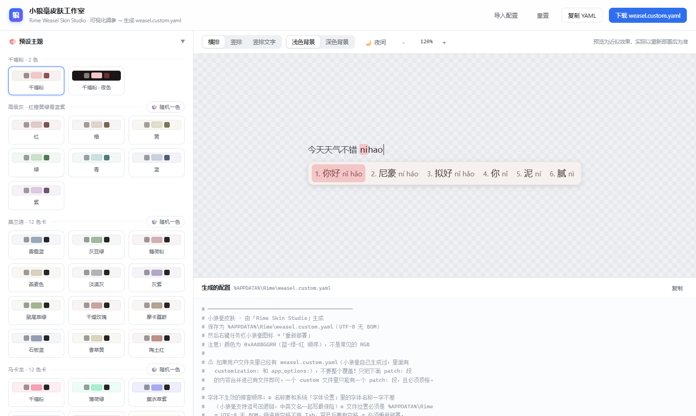
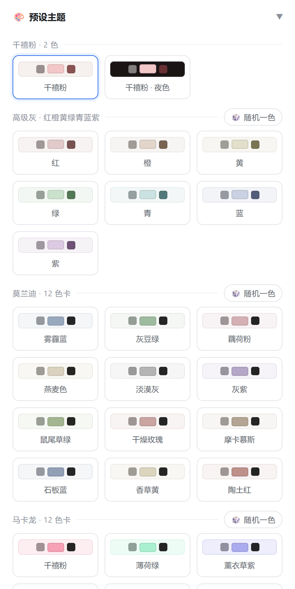
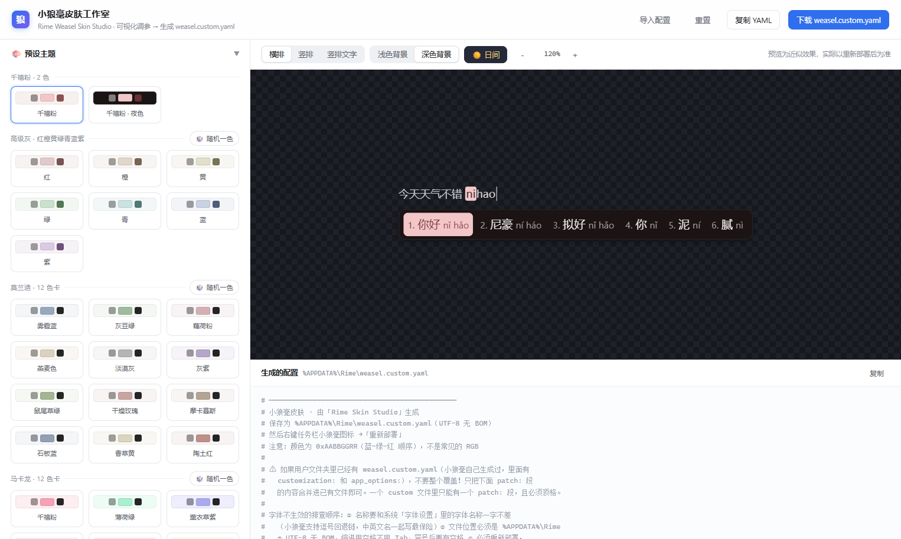
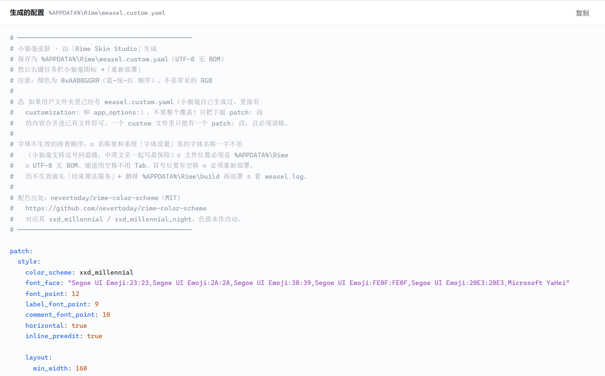

# 小狼毫皮肤工作室 · Rime Weasel Skin Studio

> 一个零依赖的单文件网页工具：可视化调参小狼毫（Weasel）输入法皮肤，实时预览，一键生成 `weasel.custom.yaml`。

[](LICENSE)




## 👉 [点此在线使用（无需下载安装）](https://jgcindy.github.io/rime-weasel-skin-studio/)

**不需要安装任何东西，不需要联网。** 在线地址打开即用；也可以把仓库下载下来双击 `index.html`。

> **关于文件名**：主程序叫 `index.html`，它就是原来的 `rime-skin-studio.html` 改名而来，
> 内容一模一样。改名只有一个原因 —— **GitHub Pages 只把 `index.html` 当作目录入口**，
> 叫这个名字，在线地址才能直接用根路径打开（`.../rime-weasel-skin-studio/`），
> 而不用写成 `.../rime-weasel-skin-studio/rime-skin-studio.html`。

---

## 在线使用

**👉 https://jgcindy.github.io/rime-weasel-skin-studio/**

如果上面的地址一时打不开（GitHub Pages 在部分地区网络可能较慢或被拦截），可以先用这个备用地址：

**https://raw.githack.com/JGCindy/rime-weasel-skin-studio/main/index.html**

> ⚠️ **注意**：在 GitHub 的仓库文件列表里**点击 `index.html`，看到的是源代码，不会运行**。
> 这是 GitHub 的行为 —— 它把 `.html` 当文本展示。想直接用请走上面的在线地址，或下载后双击。

---

## 它解决什么问题

给小狼毫换皮肤，官方做法是手写 `%APPDATA%\Rime\weasel.custom.yaml`：

- 颜色是 **`0xAABBGGRR`**（蓝-绿-红顺序），不是常见的 RGB，手算极易出错；
- 字体名要和系统「字体设置」里一字不差，中文名、英文名、回退链写法各不相同；
- 布局参数十几个（圆角、留白、间距、阴影、高亮块内边距…），改一个要重新部署一次才能看效果；
- `patch:` 只能写在 `.custom.yaml` 里，粘进方案文件完全无效 —— 这个坑官方文档没强调过。

本工具把这些全都变成**拖滑块 + 实时预览**，右边画布直接看效果，满意了再复制 YAML。

---

## 快速上手

1. 打开 `index.html`（或点右上角 `导入配置` 把已有的 `weasel.custom.yaml` 粘进来继续改）。
2. 左边调参 —— 预设主题、配色、字体、候选窗布局、阴影、方案名称。
3. 点右上角 **`下载 weasel.custom.yaml`**，保存到 `%APPDATA%\Rime\weasel.custom.yaml`。
4. 右键任务栏小狼毫图标 → **重新部署**。

> 已有该文件时**不要整个覆盖** —— 小狼毫自己生成的里面还有 `customization:` 和 `app_options:`，
> 只把生成的 `patch:` 段合并进去即可。一个 custom 文件里只能有**一个** `patch:` 段，且必须顶格。

---

## 功能

### 预设主题

| 分组 | 色数 | 说明 |
| --- | --- | --- |
| 千禧粉 | 2 | **取自 [nevertoday/rime-color-scheme](https://github.com/nevertoday/rime-color-scheme)（MIT）** 的 `xxd_millennial` / `xxd_millennial_night`，色值原样保留，含官方夜色版 |
| 高级灰 | 红橙黄绿青蓝紫 | 低饱和彩灰，克制耐看 |
| 莫兰迪 | 12 色卡 | 雾霾蓝、灰豆绿、藕荷粉… 蒙着灰的高级感 |
| 马卡龙 | 12 色卡 | 千禧粉、薄荷绿、薰衣草紫… 甜而不腻 |
| 多巴胺 | 12 色卡 | 热粉、亮橙、柠檬黄、克莱因蓝… 高饱和快乐色 |
| 完全随机 | ∞ | **预设之外**：色相全域随机，自动中文命名，可反复摇 |

每个具名色卡都附带颜色名称，选完即得到一整套协调的配色（底色 / 边框 / 三种文字色 / 高亮块 / 阴影的亮度、饱和度关系都是按色系规则派生的，不是随手填的数值）。



### 配色

15 个颜色字段全部可视化编辑，每项独立控制色相、透明度（α）：

```
底色 / 边框 / 阴影 / 编码文字 / 高亮编码文字 / 高亮编码底 /
候选词文字 / 序号 / 注音注解 / 选中词文字 / 选中词背景 /
选中词序号 / 选中词注音 / 翻页提示 / 回页提示
```

**可读性有兜底**：界面会按 WCAG 对比度实时检查文字与背景，主文字低于 4.5:1、注释低于 3:1 时自动改用同色系里对比度达标的明度，避免出现「高亮块糊成一团」「光标处灰字看不清」这类问题。

### 字体

候选词 / 序号 / 注音三组字体独立设置字体名与字号，并自动为字体名补上 emoji 回退链。支持隐藏注音（`comment_font_point: 0`）。

### 候选窗布局

圆角半径、高亮块圆角、边框粗细、左右/上下留白、候选项间距、区间间距、序号与词距、高亮块内边距、最小宽度、阴影（模糊半径 / 水平偏移 / 垂直偏移）、横排候选、编码内嵌、竖排及其列序。

### 夜间模式

顶栏 **`🌙 夜间`** 按钮：以当前配色的**强调色**为色相基准，派生一套深色配色（默认对齐千禧粉夜景），画布同步切深色。切换预设会自动退出夜间，避免配色打架。



### 关于「声开关行为」（重点）

顶栏的 **`全局记住`** / **`各应用独立`** 对应小狼毫的「声」字符开关行为。这一点有个官方机制上的坑：

> 小狼毫 0.17.4 的 F4 开关切换是**临时的，且仅对当前窗口生效**；
> `save_options` 里的 `RestoreSavedOptions()` 只在**从选单选方案**时才被调用，
> **新会话启动不会恢复**。所以靠 `save_options` 无法真正实现「全局记住」。

参考：rime/librime#255、rime/home#138（作者 lotem 的说明）。

因此本工具生成的配置脚本改为**直接写 schema 的 `reset` 参数**：

- `reset: 1` → 全局强制打开，所有应用一致；
- `reset: 0` → 各应用独立，按 F4 切换。

这是不依赖恢复机制的确定行为。工具里附带的 `.bat` 脚本会自动扫描源目录与 `build/` 下的 `*.schema.yaml` 并写入对应值，同时清理 `default.custom.yaml` / `build/default.yaml` 里 `save_options` 的残留，并把 `user.yaml` 里存着的旧开关值一并纠正——那正是「刚设好、重开应用又变回去」的典型原因。

#### 在另一台电脑上跑了却没生效？

先看脚本窗口里这几行，它们会直接说明问题：

| 输出 | 含义 |
| --- | --- |
| `[OK] Rime user folder: <路径>` | 脚本实际改的是哪个资料夹。若这不是你在用的那个，后面全白做 |
| `[OK] source schemas: N found, M contain tone_display` | 找到几个方案文件、其中几个带「声」。`M` 为 0 就是没找到对的资料夹 |
| `[WARN] WeaselDeployer.exe not found` | 文件改了但**没重新部署**，所以不生效 |
| `[WARN] No schema contains a tone_display switch` | 该资料夹里没有支持「声」的方案 |

常见的三种不生效原因，脚本都已针对性处理：

1. **用户资料夹不在默认位置**。小狼毫允许自定义资料夹，真实位置记在注册表
   `HKCU\Software\Rime\Weasel` 的 `RimeUserDir`。旧脚本硬编码 `%APPDATA%\Rime`，
   资料夹改过的机器上会「改了个空壳」却一路打印 `[OK]`。现在优先读注册表。
2. **找到的部署器不对 / 没找到**。现在优先用正在运行的 `WeaselServer.exe` 的路径反推安装目录，
   并覆盖 `%LOCALAPPDATA%\Programs`、各盘符的 `Program Files`。
3. **`sync\` 快照让人误判**。`%APPDATA%\Rime\sync\<installation_id>\` 里有一份方案备份，
   它不参与加载。脚本已把它（以及 `preview\`、`plum\`）排除，避免「改了 16 个文件」这种假象。

**如果还是不行**，用仓库根目录下的 **`声全局-修复诊断.bat`**：它只做诊断+修复，并把完整报告写到桌面
（`rime-tone-report-*.txt`），内容包括用户资料夹候选、每个方案文件的 `reset` 当前值、`build` 编译产物状态、
`user.yaml` 残留、`lua/super_preedit.lua` 是否存在、部署器路径、以及修复后的复核结果。把这份报告发出来就能定位。

> 只诊断不改动：把 bat 拖进 cmd，加参数 `diag`（即 `声全局-修复诊断.bat diag`）。
> 只改不部署：加参数 `noredeploy`。
> 资料夹既不在注册表也不在默认位置（便携安装）：先 `set TONEDIR=D:\某处\Rime` 再运行。

---

## 生成的 YAML 长什么样



```yaml
patch:
  style:
    color_scheme: my_skin
    font_face: "Microsoft YaHei, Segoe UI Emoji"
    font_point: 15
    label_font_point: 13
    comment_font_point: 0   # 0 = 不显示候选词旁的注解（注音）
    horizontal: true
    inline_preedit: true

    layout:
      min_width: 160
      border_width: 1
      margin_x: 12
      margin_y: 8
      corner_radius: 8
      hilited_corner_radius: 6
      spacing: 8
      candidate_spacing: 12
      hilite_spacing: 6
      hilite_padding_x: 10
      hilite_padding_y: 6
      shadow_radius: 0
      shadow_offset_x: 0
      shadow_offset_y: 0

  # 用 "/+" 合并进已有配色，避免覆盖掉内置方案
  "preset_color_schemes/+":
    my_skin:
      name: 我的皮肤
      back_color: 0xFFF8F7F7   # 候选窗底色（0xAABBGGRR）
      border_color: 0xFFE6E3E3 # 边框颜色
      shadow_color: 0x2A000000 # 阴影颜色
      # ...
```

注意颜色是 **`0xAABBGGRR`**（蓝-绿-红），不是 RGB —— 工具会自动转换，不用手算。

---

## 兼容性

- **输入法**：小狼毫 Weasel（Windows），0.17.x 实测；Linux 的 fcitx5-rime / macOS 的鼠须管支持大部分 `style` 与 `preset_color_schemes` 字段，但 `weasel.custom.yaml` 是 Windows 专属，其他平台请把 `patch:` 内容搬到对应的 `*.custom.yaml`。
- **浏览器**：Chrome / Edge / Firefox / Safari 现代版本均可，纯前端，无网络请求。
- **操作系统**：Windows / macOS / Linux 都能打开编辑，生成的 YAML 供 Windows 端使用。

---

## 仓库结构

```
rime-weasel-skin-studio/
├── index.html            # 全部代码：HTML + CSS + JS 单文件，无外部依赖（原 rime-skin-studio.html）
├── 声全局-修复诊断.bat    # 「声」开关诊断+修复脚本（见上文「在另一台电脑上跑了却没生效？」）
├── docs/                 # README 里的界面截图
├── README.md
└── LICENSE
```

`声全局-修复诊断.bat` 是独立的排障工具，正常路径用不上——直接从网页下载 `声全局.bat` 双击即可。
它只在「换了台电脑，脚本报了一堆 OK 但『声』还是不对」时使用，会输出一份可发出来求助的报告。

---

## 开启在线访问（GitHub Pages）

因为入口文件名正好是 `index.html`，**不需要任何额外配置**，开启后根路径就能直接访问：

1. 打开仓库的 **Settings** → 左侧栏 **Pages**
2. **Source** 选 `Deploy from a branch`
3. **Branch** 选 `main`，目录选 `/ (root)`，点 **Save**
4. 等 30 秒～1 分钟，访问 👉 **https://jgcindy.github.io/rime-weasel-skin-studio/**

之后每次 `git push`，Pages 会自动重新构建，不需要再设置。

---

## 致谢与配色来源

**「千禧粉 / 千禧粉 · 夜色」** 这两套预设直接取自
[nevertoday/rime-color-scheme](https://github.com/nevertoday/rime-color-scheme)（**MIT** 协议），
对应其 `xxd_millennial` 与 `xxd_millennial_night`，**色值原样保留、未作改动** ——
包括高亮块的千禧粉 `#F3C6C8` 和夜色的近粉黑底 `#1A1415`。
该仓库给了 20 套品牌色配色（蒂芙尼蓝、爱马仕橙、克莱因蓝…每套带浅色 + 夜色），推荐去看看。

本工具对它的致敬之处在于：**夜间按钮的派生逻辑正是照着「千禧粉 → 千禧粉 · 夜色」的映射方式反推的** ——
夜底的色相取强调色（高亮块）的色相而不是背景的色相，这样派生出来的夜色才会像官方那样保留一丝粉调，而不是死灰。

其余部分来源如下：

| 内容 | 来源 |
| --- | --- |
| 千禧粉 / 千禧粉 · 夜色 | [nevertoday/rime-color-scheme](https://github.com/nevertoday/rime-color-scheme)（MIT），色值原样 |
| 莫兰迪 / 马卡龙 / 多巴胺 色卡 | 公开色卡的通行叫法与常用 HEX（如克莱因蓝 `#002FA7` 为公开记载的品牌色值） |
| 整套配色的明度 / 彩度 / 阴影派生规则 | 本工具按各色系特征自行推导 |
| 界面、代码、文案 | 本仓库原创，[MIT](LICENSE) |

选了千禧粉那两套预设时，导出的 `weasel.custom.yaml` 头部注释里也会自动带上这条出处，方便转给别人时对方也能知道来源。

---

## 许可

[MIT](LICENSE) © 2026 JGCindy

---

## 相关链接

- [Rime 官网](https://rime.im/)
- [小狼毫（Weasel）仓库](https://github.com/rime/weasel)
- [Rime 配置指南 · 定制外观](https://github.com/rime/home/wiki/CustomizationGuide)
